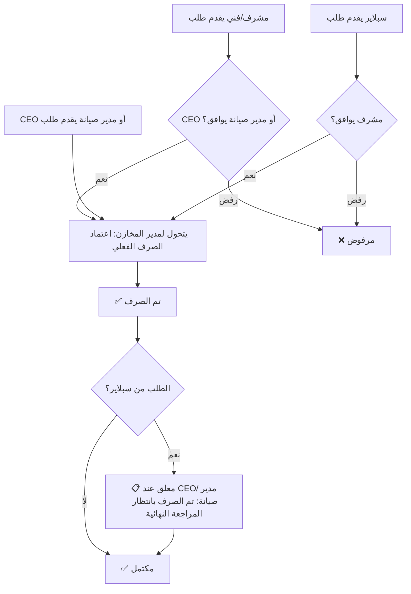

# سجل القرارات — The Calm WMS 2.0

---

## الأدوار والصلاحيات

> [!IMPORTANT]
> هذا الجدول مستخرج من **الكود الفعلي** + **توضيح صاحب المشروع** (محمد حلمي — مدير المخازن).
> آخر تحديث: 2026-08-04

### الأدوار المعرّفة في الكود

**مصدر 1:** [schema.ts](file:///C:/Users/Mohamed Helmy/Downloads/The_Calm_WMS_V2.1/wms-monorepo/packages/domain/src/schema.ts#L91) → `"pending" | "user" | "admin" | "management" | "blocked"`

**مصدر 2:** [AuthContext.tsx](file:///C:/Users/Mohamed Helmy/Downloads/The_Calm_WMS_V2.1/wms-monorepo/apps/web/src/contexts/AuthContext.tsx#L16) → يضيف أيضاً: `"CEO" | "WH_MANAGER" | "MANAGER" | "SUPERVISOR" | "ADMIN"`

**مصدر 3:** [triggers.ts](file:///C:/Users/Mohamed Helmy/Downloads/The_Calm_WMS_V2.1/wms-monorepo/functions/src/auth/triggers.ts#L50) → يترجم: `admin → WAREHOUSE_MANAGER` | `management → MANAGEMENT` | `user → USER`

**مصدر 4:** [seed.ts](file:///C:/Users/Mohamed Helmy/Downloads/The_Calm_WMS_V2.1/wms-monorepo/functions/scripts/seed.ts#L21-L27) → الأدوار المزروعة فعلياً:

| البريد | role | roleClass | category |
|--------|------|-----------|----------|
| `admin@calm.local` | `admin` | `role-admin` | الكل |
| `manager@calm.local` | `management` | `role-management` | الكل |
| `tech1@calm.local` | `user` | `role-user` | أدوات كهربائية |
| `pending@calm.local` | `pending` | (فارغ) | أدوات صحية وسباكة وشبكات |
| `blocked@calm.local` | `blocked` | (فارغ) | أدوات كهربائية |

---

### جدول الصلاحيات الرسمي

> [!WARNING]
> **تناقض مكتشف:** الكود الحالي يستخدم مزيجاً من أسماء الأدوار (`admin` + `CEO` + `WH_MANAGER` + `MANAGER`...) بشكل غير موحد.
> يجب توحيدها قبل الإنتاج. القرار النهائي مُوثّق أدناه.

#### الأدوار النهائية (بعد توضيح صاحب المشروع)

| Role (في Firestore) | roleClass | الوصف العربي | الشخص |
|---------------------|-----------|-------------|-------|
| `admin` | `role-admin` | أمين / مدير المخازن | محمد حلمي (أنت) |
| `management` | `role-management` | إدارة عليا (المدير التنفيذي أو مدير الصيانة) | — |
| `user` | `role-user` | مشرف / فني / مقاول (مستخدم عادي) | — |
| `pending` | — | حساب جديد بانتظار الموافقة | — |
| `blocked` | — | محظور من النظام | — |

#### مصفوفة الصلاحيات التفصيلية

| الإجراء | `admin` (مدير المخازن) | `management` (CEO / مدير صيانة) | `user` (مشرف/فني/مقاول) |
|---------|:---------------------:|:-------------------------------:|:-----------------------:|
| **Dashboard — كل الأقسام** | ✅ | ✅ | ❌ |
| **Dashboard — قسمه فقط** | — | — | ✅ |
| **المخزون — عرض كل الأصناف** | ✅ | ✅ | ❌ |
| **المخزون — عرض أصناف قسمه** | — | — | ✅ |
| **إضافة صنف جديد** | ✅ | ❌ | ❌ |
| **تسجيل وارد (إذن إضافة)** | ✅ | ❌ | ❌ |
| **اعتماد صرف فعلي** | ✅ | ❌ | ❌ |
| **إنشاء طلب صرف** | ✅ | ✅ | ✅ |
| **اعتماد طلب (موافقة إدارية)** | ❌ | ✅ | ❌ * |
| **اعتماد طلب سبلاير** | ❌ | ❌ | ✅ (المشرف فقط) |
| **تسجيل هالك** | ✅ | ❌ | ❌ |
| **عرض دفاتر الإضافة** | ✅ | ✅ (اطلاع فقط) | ❌ |
| **عرض دفاتر الصرف** | ✅ | ✅ (اطلاع فقط) | ❌ |
| **عرض دفتر الهالك** | ✅ | ✅ (اطلاع فقط) | ❌ |
| **التقارير** | ✅ | ✅ | ✅ (قسمه فقط) |
| **الرسوم البيانية** | ✅ | ✅ | ✅ (قسمه فقط) |
| **إدارة المستخدمين** | ✅ | ✅ | ❌ |
| **الإعدادات** | ✅ | ✅ | ❌ |

> \* المشرف يعتمد طلبات السبلاير فقط، لا يعتمد طلبات المشرفين الآخرين.

---

#### سيناريوهات الصرف (Workflow)

#### الصفحات المتاحة لكل دور

| الصفحة | `admin` | `management` | `user` |
|--------|:-------:|:------------:|:------:|
| `/login` | ✅ | ✅ | ✅ |
| `/register` | ✅ | ✅ | ✅ |
| `/dashboard` | ✅ كامل | ✅ كامل | ✅ قسمه |
| `/inventory` | ✅ + إضافة | ✅ اطلاع | ✅ قسمه |
| `/requests` | ✅ + صرف | ✅ + موافقة | ✅ + طلب |
| `/additions` | ✅ تسجيل | ✅ اطلاع | ❌ |
| `/disbursements` | ✅ تسجيل | ✅ اطلاع | ❌ |
| `/scrap` | ✅ تسجيل | ✅ اطلاع | ❌ |
| `/reports` | ✅ كامل | ✅ كامل | ✅ قسمه |
| `/charts` | ✅ كامل | ✅ كامل | ✅ قسمه |
| `/users` | ✅ | ✅ | ❌ |
| `/settings` | ✅ | ✅ | ❌ |

---

### الكود الذي يحتاج توحيد

> [!CAUTION]
> الملفات التالية تستخدم أسماء أدوار قديمة/مختلطة يجب توحيدها:

| الملف | المشكلة |
|-------|---------|
| [AuthContext.tsx:L16](file:///C:/Users/Mohamed Helmy/Downloads/The_Calm_WMS_V2.1/wms-monorepo/apps/web/src/contexts/AuthContext.tsx#L16) | union فيه `CEO`, `WH_MANAGER`, `MANAGER`, `SUPERVISOR`, `ADMIN` — غير مستخدمة في seed |
| [triggers.ts:L50](file:///C:/Users/Mohamed Helmy/Downloads/The_Calm_WMS_V2.1/wms-monorepo/functions/src/auth/triggers.ts#L50) | يترجم `admin` → `WAREHOUSE_MANAGER` في roleIds (legacy) |
| [requests/page.tsx:L29](file:///C:/Users/Mohamed Helmy/Downloads/The_Calm_WMS_V2.1/wms-monorepo/apps/web/src/app/requests/page.tsx#L29) | يتحقق من `CEO`, `WH_MANAGER` بجانب `admin` |
| [dashboard/page.tsx:L33](file:///C:/Users/Mohamed Helmy/Downloads/The_Calm_WMS_V2.1/wms-monorepo/apps/web/src/app/dashboard/page.tsx#L33) | نفس التحقق المختلط |
| [Sidebar.tsx:L34](file:///C:/Users/Mohamed Helmy/Downloads/The_Calm_WMS_V2.1/wms-monorepo/apps/web/src/components/layout/Sidebar.tsx#L34) | يتحقق من 5 أسماء أدوار |

**القرار:** الأدوار الرسمية هي: `admin` | `management` | `user` | `pending` | `blocked` فقط.
يجب تنظيف كل الإشارات للأسماء القديمة (`CEO`, `WH_MANAGER`, `MANAGER`, `SUPERVISOR`).
